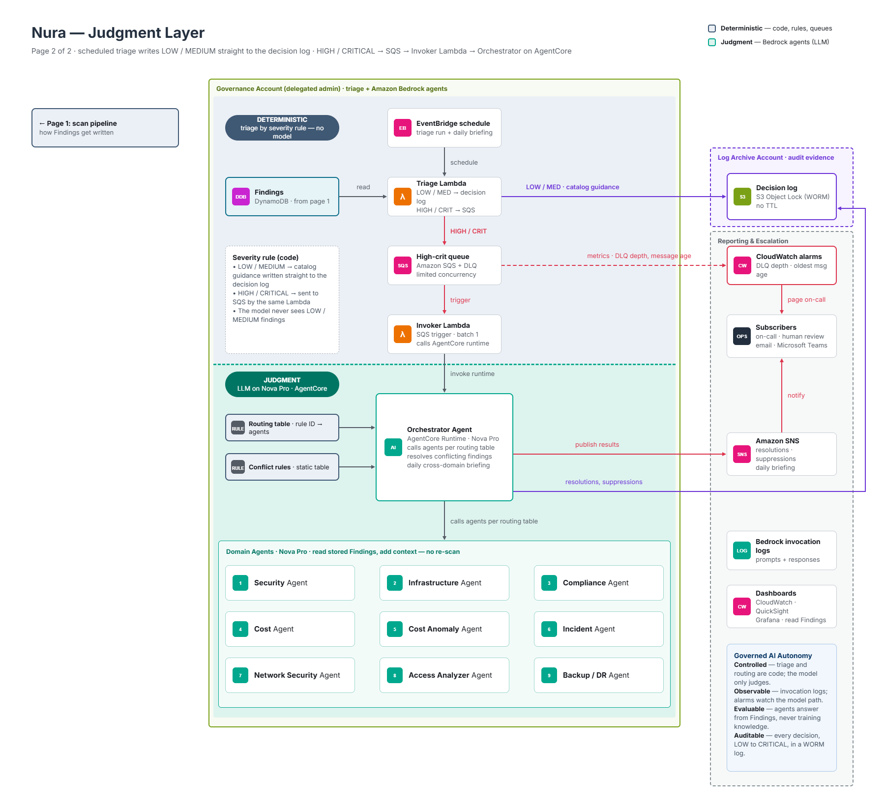

# Nura: Judgment Layer

Nura is a multi-account AWS governance platform. It continuously checks every account in an AWS Organization across nine domains: security, infrastructure, compliance, cost, cost anomaly, incident, network security, access analyzer, and backup/DR. It then decides, with evidence, what should be done about each problem it finds.

Most governance tools stop at a list of findings. Nura's goal is to go one step further without giving up control:

- **Find problems reliably.** Checks are plain code with no model in the loop, so the same account always produces the same findings.
- **Judge them with context.** For serious findings, AI agents look at what a static rule can't see, such as the resource's tags, who changed it recently, and what it costs. They then say whether the recommended action should go ahead.
- **Stay governed.** Code decides which agents are asked and what they're allowed to recommend. Humans approve anything risky, and every decision is kept as tamper-proof audit evidence.

This repository is the **judgment layer**. It takes stored findings and turns them into decisions.

## Deterministic vs. judgment: two projects

Nura is split into two projects on purpose:

| | Scanner project (deterministic) | This project (judgment) |
|---|---|---|
| Job | Find problems | Decide what to do about them |
| How | Checkers (plain code) run on a schedule against every member account | Rules route each finding to AI agents; code resolves their opinions |
| Uses a model? | **Never** | Only for HIGH and CRITICAL findings |
| Output | Findings in the `Findings` DynamoDB table | Decisions in the decision log (S3) and on SNS |

The two projects meet only at the `Findings` table. The scanner writes findings; this project reacts to them. Keeping them apart means:

- **Detection is never affected by a model.** A finding exists because a checker measured something, not because an LLM decided it should.
- **The model never re-scans.** Agents read the stored finding and add context. They don't discover new problems.
- **Each side can be deployed, tested and changed on its own.** This repository runs without the scanner: you can load findings yourself (see [Load findings](#4-load-findings)).

## Architecture



A finding moves through these steps:

1. **Findings table.** The scanner (or `scripts/seed_findings.py`) writes findings to DynamoDB. The table's change stream starts everything else.
2. **Triage Lambda.** Plain code, no model. It applies the severity rule:
   - **LOW / MEDIUM:** a locked *triage* record (the finding plus its catalog recommendation) is written straight to the decision log. The model never sees these.
   - **HIGH / CRITICAL:** the finding is put on the `nura-high-critical` SQS queue.

   The trigger filters stream events before the Lambda runs, so only *new* findings and *escalations* get through: LOW/MEDIUM → HIGH/CRITICAL, or HIGH → CRITICAL. Rescans that only update `last_seen_at` cost nothing, and each finding is judged once.
3. **Invoker Lambda.** Takes one message at a time, with limited concurrency, and calls the AgentCore runtime. After 3 failed attempts a finding goes to a dead-letter queue, so it is never lost.
4. **Orchestrator on Bedrock AgentCore Runtime.** One container holding the orchestrator and all nine domain agents:
   - **Routing** (code): the finding's rule ID picks the owning agent and any secondary agents from the rulesets in [`rulesets/`](rulesets/).
   - **Synthesis** (the only model step): each agent (Amazon Nova Pro, via Strands Agents) uses read-only tools and returns a structured opinion. Every agent can read resource tags and CloudTrail activity; each also has tools for its own domain (see [Domain agents and their tools](#domain-agents-and-their-tools)).
     - If the rule recommends an action, the owner agent confirms it or softens it.
     - If the rule recommends none (most security rules), the owner agent *assesses* the finding: no action, monitor, or a containment action proposed to a person.
   - **Conflict rules** (code): a fixed table settles disagreements between agents, such as evidence hold vs. delete or approved change vs. cleanup. Anything the rules don't cover goes to a human.
   - **Remediation policy** (code): the rule decides whether an action may run automatically, needs approval, or is manual only. An action an agent proposes without a rule behind it is marked `PROPOSED`: a person decides.
5. **Outputs.**
   - **Decision log:** every decision is written to S3 Object Lock (WORM), *before* anyone is notified.
   - **SNS topic:** receives a compact summary with message attributes (`requires_human`, `outcome`, `severity`, …), so email, on-call and Microsoft Teams subscribers can each filter for what they need.

The diagram shows the target design. Differences from what deploys today:

- Triage runs on the DynamoDB stream rather than an EventBridge schedule, which is cheaper and avoids re-judging the same findings.
- The decision log sits in the governance account rather than a separate Log Archive account.
- CloudWatch alarms, dashboards and the daily briefing are not built yet.

See [Status](#status).

## The four pillars of governed AI autonomy

Nura lets agents make recommendations, but only inside a frame that keeps them **Controlled, Observable, Evaluable and Auditable**. Here is how this project implements each pillar.

### Controlled: code decides, the model only judges
- **Code picks the agents, not the model.** The rule ID selects them from versioned rulesets ([`routing.py`](src/agents/orchestrator/routing.py)), and the severity rule keeps LOW/MEDIUM away from the model altogether.
- **The model can only choose from allowed actions.** Its answer is a structured response restricted to the actions its role permits ([`synthesize.py`](src/agents/orchestrator/synthesize.py), [`conflict_rules.py`](src/agents/orchestrator/conflict_rules.py)). It cannot invent new ones.
- **The agent can propose, but cannot act on its own.** When a rule has no action, the agent may only propose its own domain's containment actions (for the security agent: `CLOSE_PATH`, `REVOKE`, `ROTATE_KEY`, `ISOLATE`, `QUARANTINE`, `ENCRYPT_CMK`, `PRESERVE`). Such a decision always requires a human and is never executed.
- **Disagreements are settled by a static table.** Anything the table doesn't cover escalates to a human ([`conflicts.py`](src/agents/orchestrator/conflicts.py)).
- **The rule decides how an action may happen.** `requires_approval` and `eligible_when` settle whether it can run automatically, needs approval, or is manual ([`remediation.py`](src/agents/orchestrator/remediation.py)). The model cannot override this.
- **Least privilege throughout.** The agents' tools are read-only. Each component has its own narrowly scoped IAM role. The triage Lambda can write only `triage/` records, and the runtime only `decisions/` records.

### Observable: you can see what the model did
- **Traces.** The runtime is auto-instrumented with OpenTelemetry (ADOT), so every judgment appears in CloudWatch GenAI Observability. The OTel `trace_id` is stored with each decision.
- **Tool trace.** Each opinion records the tool calls it made: the input, status, a preview of the output and a SHA-256 of the full output. You can see *why* an agent concluded what it did.
- **Logs.** The Lambdas log one structured line per finding (queued, logged, judged, dropped). Failures land in DLQs you can inspect: `nura-high-critical-dlq` and `nura-triage-failures`.

### Evaluable: answers you can check
- **Answers are grounded in evidence.** Agents answer from the stored finding and their tool output, never from general training knowledge, and the prompt states that missing data proves nothing.
- **Opinions are structured.** Each has an action, rationale, evidence and observations (related risk, data quality, ruleset gaps), plus a `needs_review` flag when the agent isn't sure. Because they're structured rather than free text, they can be compared and scored.
- **The deterministic steps are unit-tested.** Routing, conflict resolution, remediation, triage and the decision log are all covered (`uv run pytest`). The model step is tested with fake agents, so the surrounding logic is checked without calling Bedrock.
- **The model step is measured against a golden dataset** using suppression rate, fabrication rate and a confusion matrix. See [Evaluating the judgments](#evaluating-the-judgments).

### Auditable: every decision, LOW to CRITICAL, in a WORM log
- **One immutable record per decision, in S3 with Object Lock.** Each record is checksummed (SHA-256) and written with `If-None-Match`, so an existing record can never be overwritten.
- **Two prefixes:**
  - `decisions/`: agent judgments, holding the full finding, every opinion and tool trace, the conflict-rule outcome and the execution mode;
  - `triage/`: LOW/MEDIUM records with their catalog recommendation.
- **Locks can't be removed early.** On a bucket this project creates, the bucket policy denies `s3:BypassGovernanceRetention` to everyone, so removing a lock early first requires editing the policy, and CloudTrail records that edit.
- **Every SNS message links to its record** (`decision_record: s3://…`), so each notification points at evidence that already exists.

## Evaluating the judgments

Unit tests prove that the code around the model behaves. They can't tell you whether the agents' *judgments* are any good. For that, Nura measures the model step against a **golden dataset**: a set of findings where people have agreed the correct decision in advance.

### Why it pays off

The agents can make two kinds of mistake, and they aren't equally costly:

- **Wrongly holding back** ("don't release this IP, it's in use") leaves risk or waste in place and hides it behind an agent's reasoning.
- **Wrongly going ahead** ("safe to delete") is the mistake approval gates exist to catch.

A golden dataset turns "the agent seems sensible" into numbers you can track. Those numbers let you:

- **Gate changes.** Run the set before changing a prompt, a model (for example Nova Pro → Claude), a tool or a ruleset. A change that raises false suppression or fabrication doesn't ship.
- **Earn autonomy rule by rule.** Move a rule from `APPROVAL` to `AUTO` only once its golden cases show high agreement and zero false suppressions. Autonomy is granted on evidence, not trust.
- **Find weak spots.** The confusion matrix shows *which* rules, domains or situations the agents get wrong, such as production tags, missing data or conflicting agents. That tells you whether to fix a prompt, a tool, a conflict rule or the ruleset.
- **Give auditors evidence.** The scores, and the dataset they came from, show that the Evaluable pillar is measured and not just claimed.

### Building the golden dataset

Each golden case is a finding plus the context the agent will see, plus the expected answer:

```jsonc
{
  "case_id": "cost-eip-tag-only-activity",
  "finding": { "rule_id": "COST-EC2-004", "severity": "CRITICAL", "resource_id": "eipalloc-...", "...": "..." },
  "context": {                       // recorded tool outputs, replayed instead of calling AWS
    "get_resource_tags": { "tags": {"env": "prod", "project": "nura"} },
    "get_recent_activity": { "events": [{"EventName": "CreateTags", "Username": "..."}] }
  },
  "expected": {
    "decision": "PROCEED",           // PROCEED | HOLD | ESCALATE
    "action": "DELETE",
    "must_not_claim": ["resource is attached", "in use"],
    "why": "Tag-only changes are not evidence of use; the EIP is still unassociated."
  }
}
```

Where cases come from:

- **Real decisions.** Every record in the decision log already holds the finding, each opinion and its tool trace. When a reviewer confirms or corrects a decision, that record becomes a golden case. The dataset grows from production.
- **Known traps,** written on purpose. For example:
  - a `do-not-delete` or `nura:exception` tag;
  - recent write activity by a person versus by a pipeline;
  - tag-only changes, like `CreateTags`, that aren't evidence of use;
  - a resource that doesn't exist, where missing data proves nothing;
  - a production tag on an obviously idle resource;
  - two agents that should disagree.
- **Coverage.** At least a few cases per rule that reaches the agents, across all nine domains as their agents are built.

Two of the traps above have already happened in testing the cost agent:
- It treated a `CreateTags` event as proof an Elastic IP was in use, a **false suppression**.
- With a made-up allocation ID, it reasoned "untagged, so safe to release". That is a conclusion drawn from missing data, and the `must_not_claim` checks are designed to catch it.

Each of these is a golden case.

**Replaying the recorded tool outputs** (the `context` above) instead of calling AWS keeps runs repeatable and cheap, and means the model is scored on the same facts every time. Run each case several times to see how much the model varies between runs.

### The metrics

Each run maps every agent opinion to **PROCEED** (go ahead with the rule's action), **HOLD** (`MONITOR` / `NO_ACTION`) or **ESCALATE** (`needs_review` or a human), and compares it with the golden answer.

**Confusion matrix** (rows = what the golden set expects, columns = what the agent said):

| expected ↓ / agent → | PROCEED | HOLD | ESCALATE |
|---|---|---|---|
| **PROCEED** | ✅ correct | ❌ **false suppression** | ⚠️ over-cautious |
| **HOLD** | ❌ **unsafe action** | ✅ correct | ⚠️ over-cautious |
| **ESCALATE** | ❌ missed escalation | ❌ missed escalation | ✅ correct |

Read it per rule and per domain. The diagonal is agreement. The off-diagonal cells say what *kind* of mistake is happening, which a single accuracy number hides.

| Metric | How it's calculated | What it tells you |
|---|---|---|
| **Suppression rate** | Share of findings the agents held back (HOLD) | How much noise the judgment layer removes. Too low: agents add nothing beyond the rule. Too high: worth checking |
| **False suppression rate** | Of findings the golden set says should go ahead, the share the agents held back | The most important number: real problems hidden by agent reasoning. Target **0** for CRITICAL rules |
| **Unsafe action rate** | Of findings the golden set says to hold, the share the agents let go ahead | How often approval gates are the only protection |
| **Fabrication rate** | Share of opinions that state a fact not found in the finding or the tool outputs, such as a tag that wasn't returned, an event that didn't happen, or a wrong number | Whether the agents stick to evidence. Target **0** |
| **Escalation rate** and **`needs_review` calibration** | How often agents escalate, and whether they flag the cases that really are hard | Whether "I'm not sure" means something |
| **Fallback / incomplete rate** | How often an agent failed and the rule's answer was used instead | How reliable the agents and their tools are |

**Fabrication is checkable here** because every opinion records its tool calls. The evaluation compares each concrete claim in `rationale`, `evidence` and `observations` (tag keys, event names, ARNs, dates, amounts) with the recorded tool outputs. Claims with no source count as fabrications, as do any `must_not_claim` phrases. A second model can grade the less structured claims, with people spot-checking its grades.

### Proposed layout

```
evals/
  golden/<domain>/<case_id>.json   golden cases (finding + recorded context + expected)
  run_evals.py                     replay each case through synthesize + conflicts, N runs
  report.md                        confusion matrix and rates per rule / domain / model
```

The decision log already stores everything needed to create cases, so the harness only needs the replay and scoring code.

## Domain agents and their tools

Each agent is a module in [`src/agents/subagents/`](src/agents/subagents/) exposing `build_agent()`. Its tools live in [`src/agents/tools/context/`](src/agents/tools/context/) and follow the same rules:

- **The finding names the resource.** A tool takes no resource argument: it reads the resource, account and region from the finding under review. The model can only choose a time window or a grouping, and a unit test checks this for every tool of every agent.
- **Read-only, facts not verdicts.** Tools describe; the agent judges.
- **One failed call never hides the rest.** Each AWS call is tried on its own. A failure is listed in the tool's `errors`; "not configured" (no bucket policy, no Security Hub) is reported as a fact.
- **No data contents.** No object contents, secret values or log lines (log tools return counts only), and policies are summarised rather than returned raw.

| Agent | Owns | Tools beyond tags and CloudTrail |
|---|---|---|
| cost | cost cleanups | Cost Explorer: EC2 / RDS / S3 spend, reservations |
| cost-anomaly | anomalies, spend spikes, anomaly-detection coverage | `get_anomaly_details` (Cost Anomaly Detection), `get_spend_breakdown` (daily spend by usage type, region, ...), `get_recent_changes` |
| security | 79 security rules | `get_resource_policy`, `get_network_exposure`, `get_principal_access`, `get_security_signals` (GuardDuty, Security Hub, Access Analyzer) |
| network-security | open security groups / NACLs, flow logs, DNS, peering, transit gateways | `get_network_config` (VPC fabric: real public subnets, NACL order, peers inside or outside the organization), `get_network_exposure`, `get_security_signals` |
| access-analyzer | external / unused access, MFA | `get_analyzer_findings`, `get_service_last_accessed` (granted vs actually used services), `get_principal_access`, `get_resource_policy` |
| compliance | CIS / SOC 2 / Config controls | `get_control_evidence` (live control state, including organization trails and prefixed organization Config rules), `get_compliance_scope` (frameworks the account actually tracks), `get_principal_access`, `get_resource_state` |
| infrastructure | cleanups and configuration of EC2, EBS, RDS, VPC | `get_resource_state` (exists? idle how long? what depends on it?), `get_resource_metrics`, `get_network_exposure` |
| backup-dr | backup plans, vaults, jobs, recovery points; guards deletes as a secondary | `get_backup_posture` (plans, copies, failed and running jobs, restore tests, recovery points), `get_resource_state` |
| incident | alarms, unhealthy targets, errors, degraded services | `get_service_health`, `get_alarms`, `get_resource_metrics`, `get_recent_changes`, `get_security_signals` |

Run any agent against a sample finding (Bedrock plus read-only AWS calls, nothing written): `uv run python -m agents.subagents.<module> <RULE_ID>`.

## Repository layout

```
src/
  agents/
    orchestrator/   routing, synthesize (LLM step), conflict rules, remediation, orchestrator_agent
    subagents/      one module per domain agent (all nine), shared model.py
    tools/context/  read-only agent tools, one module per area (see Domain agents and their tools);
                    aws_calls.py: shared per-call error handling
    runtime/app.py  AgentCore entrypoint (POST /invocations {"finding_id": ...})
  common/           findings repo (DynamoDB), decision log (S3 Object Lock), SNS publisher, sessions
  pipeline/         stream_triage.py (triage Lambda), invoker.py (invoker Lambda), triage.py (batch/local)
rulesets/           rule catalog per domain (routing, recommended action, remediation policy) + validator
deploy/             CloudFormation templates (foundation, member reader role), deploy scripts, IAM policy templates
scripts/            seed_findings.py
data/               sample_findings.json (50 example findings)
tests/              unit tests (moto for AWS, fake agents for the model step)
Dockerfile, main.py container image and entrypoint for AgentCore Runtime
```

## Deploy

### What gets created

`deploy_judgement_foundation.ps1` deploys the CloudFormation stack `nura-judgment-foundation`:

| Resource | Name (default) | Notes |
|---|---|---|
| Findings table | `Findings` | DynamoDB, on-demand. Stream (new and old images), TTL, point-in-time recovery. Kept if the stack is deleted |
| Decision log | `nura-decisionlog-<account>-<region>` | S3 with Object Lock, versioning, public access blocked, TLS required, no lifecycle expiry. Kept if the stack is deleted |
| SNS topic | `nura-findings` | Optional email subscription |
| Queues | `nura-high-critical`, `nura-high-critical-dlq`, `nura-triage-failures` | SQS-managed encryption, TLS required |
| Triage Lambda | `nura-judgment-triage` | Triggered by the Findings stream (filtered) |
| Invoker Lambda | `nura-judgment-invoker` | Created once the AgentCore runtime exists |

`deploy_runtime.ps1` builds and deploys the AgentCore runtime `nura_judgment`:
- an ARM64 container, built in AWS CodeBuild (no local Docker needed) and stored in ECR;
- its execution role `nura-judgment-runtime`, which gets only the table, bucket and topic created by the foundation stack.

### Prerequisites

- An AWS account and credentials with administrator-level rights to create IAM roles, CloudFormation stacks, ECR, CodeBuild, Lambda and Bedrock AgentCore resources.
- A region where **Amazon Bedrock AgentCore** is available, with **model access granted for Amazon Nova Pro** (`amazon.nova-pro-v1:0`) under Bedrock → Model access.
- [AWS CLI v2](https://docs.aws.amazon.com/cli/latest/userguide/getting-started-install.html), [uv](https://docs.astral.sh/uv/), and PowerShell (Windows PowerShell 5.1, or PowerShell 7 on macOS/Linux).
- Python dependencies, installed from the repository root:
  ```powershell
  uv sync --extra agents
  ```
  Always include `--extra agents`; without it, `uv sync` removes Strands and the AgentCore SDK.
- **Multi-account only:** a read-only role named `governance-platform-reader` in each member account, trusting the `nura-judgment-runtime` role with the external ID `governance-platform`. The scanner project provides it. Without the scanner, deploy it from this repository: see [Member accounts](#member-accounts-multi-account-only). For a single-account trial you can skip this: findings in the account you deploy to are read with the runtime's own role.

If Windows blocks the scripts ("running scripts is disabled on this system"), allow them for the current terminal only:
```powershell
Set-ExecutionPolicy -Scope Process -ExecutionPolicy RemoteSigned
```

### 1. Deploy the foundation

From the repository root:
```powershell
.\deploy\deploy_judgement_foundation.ps1 -NotificationEmail you@example.com
```
Confirm the subscription email from AWS. At the end, the script prints the values to put in your `.env` for local runs.

| Parameter | Default | Purpose |
|---|---|---|
| `-Region` | `$env:AWS_REGION`, else `us-east-1` | Where everything is deployed |
| `-FindingsTable` | `Findings` | Table name |
| `-DecisionLogBucket` | `nura-decisionlog-<account>-<region>` | Must be globally unique |
| `-TopicName` | `nura-findings` | SNS topic name |
| `-NotificationEmail` | none | Subscribes an email address to the topic |
| `-RetentionDays` | `1` | Object Lock retention of decision records. **Use `2555` (about 7 years) in production** |
| `-LockMode` | `GOVERNANCE` | `COMPLIANCE` cannot be removed by anyone, including root, until it expires. Never test with it |

**Reusing what you already have.** If a table, bucket or topic with the given name already exists in the account, the script reuses it instead of creating it, and never modifies it. An existing table must have a `NEW_AND_OLD_IMAGES` stream (the script prints the command to enable one), and an existing bucket must have Object Lock enabled.
```powershell
.\deploy\deploy_judgement_foundation.ps1 -DecisionLogBucket my-existing-bucket -TopicName MyExistingTopic
```

### 2. Deploy the AgentCore runtime

```powershell
.\deploy\deploy_runtime.ps1
```
Takes about 5–10 minutes, mostly the image build. The script reads the table, bucket and topic names from the foundation stack, fills them into the IAM policy templates in [`deploy/iam/`](deploy/iam/), and passes them to the runtime as environment variables. Rerun it after code or ruleset changes to redeploy.

### 3. Connect the invoker

```powershell
.\deploy\deploy_judgement_foundation.ps1      # same parameters as step 1
```
The foundation stack finds the runtime and adds the invoker Lambda. The pipeline is now complete.

### Member accounts (multi-account only)

Findings from another account are read through a role in that account. [`deploy/member-reader-role.yaml`](deploy/member-reader-role.yaml) creates it:
- name `governance-platform-reader`;
- assumable only by `nura-judgment-runtime` in your governance account, and only with the external ID `governance-platform`;
- permissions: exactly the read calls the agents' tools make, nothing more. A unit test keeps this list in sync with the tool statements of [`deploy/iam/runtime-policy.json`](deploy/iam/runtime-policy.json).

Skip it if the scanner project already created the role.

One member account (run with that account's credentials, for example `--profile member`):
```powershell
aws cloudformation deploy --stack-name nura-member-reader --template-file deploy/member-reader-role.yaml `
  --capabilities CAPABILITY_NAMED_IAM --parameter-overrides GovernanceAccountId=<governance-account-id>
```

Every account in an OU, from the management account (or a StackSets delegated administrator, adding `--call-as DELEGATED_ADMIN`). New accounts in the OU get the role automatically. IAM is global, so one region is enough:
```powershell
aws cloudformation create-stack-set --stack-set-name nura-member-reader `
  --template-body file://deploy/member-reader-role.yaml --capabilities CAPABILITY_NAMED_IAM `
  --permission-model SERVICE_MANAGED --auto-deployment Enabled=true,RetainStacksOnAccountRemoval=false `
  --parameters ParameterKey=GovernanceAccountId,ParameterValue=<governance-account-id>
aws cloudformation create-stack-instances --stack-set-name nura-member-reader `
  --deployment-targets OrganizationalUnitIds=<ou-id> --regions us-east-1
```

| Parameter | Default | Purpose |
|---|---|---|
| `GovernanceAccountId` | (required) | Account running the AgentCore runtime |
| `RuntimeRoleName` | `nura-judgment-runtime` | The only role allowed to assume the reader |
| `ExternalId` | `governance-platform` | Must match `deploy_runtime.ps1 -MemberRoleExternalId` |
| `RoleName` | `governance-platform-reader` | Must match `deploy_runtime.ps1 -MemberRoleName` |
| `AdditionalPrincipalArn` | empty | Local runs only: your own IAM user or role in the governance account (wildcards allowed, e.g. an `AWSReservedSSO_*` role). Leave empty in production |

The trust policy names the governance account and checks the caller's role ARN in a condition, rather than naming the role as principal. So the stack can be deployed before the runtime exists, and the trust survives the runtime role being recreated.

**Testing multi-account locally:**
1. Deploy the reader with `AdditionalPrincipalArn` set to your own principal.
2. Set `MEMBER_ROLE_NAME=governance-platform-reader` in `.env`.
3. Seed a finding whose `account_id` is the member account.

**Two things the role cannot fix:**
- An SCP that denies these reads.
- Cost Explorer access in a member account, which the payer account must allow. The cost tools then report the call in their `errors`.

### 4. Load findings

Each new finding written to the table flows through the pipeline by itself. With the scanner deployed, findings arrive on their own. Without it, load them with `scripts/seed_findings.py`.

The agents look at real resources: tags, CloudTrail, cost. Findings should therefore point at **your own accounts and resources that actually exist**. Start from [`data/sample_findings.json`](data/sample_findings.json), change `account_id`, `region` and `resource_id` to real values (for example an unattached Elastic IP for `COST-EC2-004`), and save it as your own file:

```powershell
uv run python scripts/seed_findings.py --file my_findings.json --all          # everything in your file
uv run python scripts/seed_findings.py --file my_findings.json COST-EC2-004   # one rule
uv run python scripts/seed_findings.py --account 123456789012 COST-EC2-004    # retarget a sample's account
```

`seed_findings.py` writes to the table named by `FINDINGS_TABLE` in `.env` (default `Findings`). A finding is written as a dict like this; `finding_id` is always `account#region#rule_id#resource_id`:

```json
{
  "rule_id": "COST-EC2-004", "domain": "cost",
  "account_id": "123456789012", "region": "us-east-1",
  "resource_id": "eipalloc-0abc123", "resource_type": "AWS::EC2::EIP",
  "severity": "CRITICAL", "title": "Unused Elastic IP",
  "recommendation": "Release unused Elastic IP eipalloc-0abc123.",
  "evidence": {"associated": false}, "estimated_monthly_saving": 3.6,
  "ruleset_version": "1.0", "detected_at": "2026-11-05T06:00:00+00:00"
}
```

### 5. Watch it work

```powershell
aws logs tail /aws/lambda/nura-judgment-triage --follow     # queued (HIGH/CRITICAL) or logged (LOW/MEDIUM)
aws logs tail /aws/lambda/nura-judgment-invoker --follow    # outcome + decision record per finding
aws s3 ls s3://<decision-log-bucket>/ --recursive           # triage/... and decisions/... records
```

A HIGH/CRITICAL judgment takes 1–3 minutes, and the decision then arrives on the SNS topic. Agent traces are in CloudWatch → GenAI Observability, and runtime logs are under `/aws/bedrock-agentcore/runtimes/nura_judgment-*`.

**Judging a finding again.** Loading the same finding again with the same severity counts as an unchanged rescan, so it is not triaged a second time. To re-run one, delete it first:
```powershell
aws dynamodb delete-item --table-name Findings --key '{\"finding_id\": {\"S\": \"<finding_id>\"}}'
```

## Run locally

```powershell
copy .env.example .env                          # then fill in the values printed by the foundation script
uv run pytest                                   # unit tests, no AWS calls
uv run python -m agents.subagents.cost_agent COST-EC2-004             # judge a sample finding (Bedrock + AWS reads)
uv run python -m agents.subagents.cost_agent COST-EC2-004 --publish   # also write the decision log + publish to SNS
uv run python -m agents.subagents.security_agent SEC-S3-002           # assess a sample security finding
uv run python -m agents.subagents.compliance_agent COMP-CIS-012        # any agent: python -m agents.subagents.<module> <RULE_ID>
uv run python rulesets/validate_rule_sets.py    # validate the rule catalog
```

## Operations

- **Failed judgments:** check `nura-high-critical-dlq`. Once the cause is fixed, use the SQS console's *Start DLQ redrive* to retry them.
- **Failed triage:** `nura-triage-failures` holds details of stream batches that could not be processed after 5 retries.
- **Cost:** stream reads by the Lambda trigger are free, and filtered-out events are not billed. Spend scales with the number of HIGH/CRITICAL findings judged (Bedrock, AgentCore). `MaxConcurrentJudgments` (default 2) caps how many judgments run at once.

## Clean up

```powershell
uv run agentcore destroy --agent nura_judgment --delete-ecr-repo   # runtime, ECR repo, CodeBuild project + role
aws iam delete-role-policy --role-name nura-judgment-runtime --policy-name nura-judgment
aws iam delete-role --role-name nura-judgment-runtime
aws cloudformation delete-stack --stack-name nura-judgment-foundation
aws cloudformation delete-stack --stack-name nura-member-reader       # in each member account, if deployed that way
# or, for the StackSet: delete-stack-instances --stack-set-name nura-member-reader --deployment-targets OrganizationalUnitIds=<ou-id> --regions us-east-1 --no-retain-stacks, then delete-stack-set
```

The Findings table and decision log bucket are **kept** when the stack is deleted, so evidence outlives the deployment. Delete them yourself once their Object Lock retention has expired.

## Status

| Area | State |
|---|---|
| Triage (stream), queues, invoker, decision log, SNS | Built |
| Orchestrator: routing, synthesis, conflict rules, remediation policy | Built |
| Domain agents (all nine) | Built, with read-only tools per domain. Unit-tested with stubbed AWS; live-tested read-only so far: security, compliance, infrastructure (+ backup-DR as secondary) |
| `needs_review` reliability | Nova Pro does not reliably set it, even when the prompt names the exact condition (seen on a non-logging CloudTrail). Candidate fix: a deterministic escalation rule in code |
| Golden dataset and evaluation harness (`evals/`) | Planned. See [Evaluating the judgments](#evaluating-the-judgments) |
| CloudWatch alarms (DLQ depth, message age), dashboards, daily briefing | Planned |
| Decision log in a separate Log Archive account | Planned |
| Automated remediation | Decisions record the execution mode (AUTO / APPROVAL / MANUAL / PROPOSED); nothing is executed yet |
